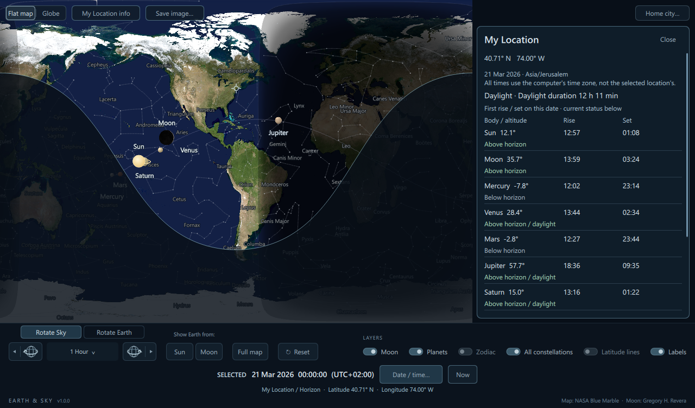

# Earth & Sky

An offline Qt Quick desktop application for Earth, daylight/twilight, the Sun, Moon, five planets and all 88 constellations. Flat-map and globe views share time navigation, layers and My Horizon. There are no accounts or runtime downloads.

[Download v1.0.0 for Windows or Linux](https://github.com/cbsom/Earth-and-Sky/releases/tag/v1.0.0) · [Installation](https://github.com/cbsom/Earth-and-Sky#download-and-install) · [Report a problem](https://github.com/cbsom/Earth-and-Sky/issues)

## Version 1.0.0

Version **1.0.0** includes direct date/time selection, a location information panel, screenshot export and refined rendering/labels. See [what’s new in 1.0](https://github.com/cbsom/Earth-and-Sky#whats-new-in-10).

## Run

On Windows, open `app/Earth-and-Sky.exe` and keep the entire app folder together. Packaged builds include Qt; users do not need an SDK. On Linux, use the published .deb or AppImage as described in the [installation guide](https://github.com/cbsom/Earth-and-Sky#download-and-install).

## Controls

- **Flat map / Globe** switches views; scroll zooms and dragging pans or turns the view.
- **Rotate Sky / Rotate Earth** selects the reference frame. The shared interval, step and play controls move through time in either direction; Escape pauses.
- **Date / time…** (Ctrl+T) selects a local or UTC instant. **Now** restores live time without resetting the view; **Reset** also returns to the home-city view.
- Click the map/globe for **My Location / Horizon**. **My Location info** shows rise/set times for the Sun, Moon and five planets, current horizon status, twilight and daylight duration. Event times use the computer's time zone, explicitly labeled. Above-horizon status does not guarantee visual visibility.
- **Full map / Full globe** fits the view and clears My Horizon without changing time. **Home city…** saves a startup/reset location.
- **Show Earth from: Sun / Moon** centers and follows that body during time changes until you manually turn the globe.
- **Save image…** (Ctrl+S) exports a clean PNG/JPEG of the current view with only very small, faded image credits beneath the view. The save confirmation disappears on any click or after five seconds. Export pauses time; use Now to resume live time.

The repository's [main README](https://github.com/cbsom/Earth-and-Sky#controls-and-saved-preferences) is the detailed control reference, including saved preferences, horizon behavior and scientific limitations. It is the authoritative guide so the two READMEs do not duplicate long instructions.

## Build, test and package

Use the main README's [Windows build](https://github.com/cbsom/Earth-and-Sky#build-on-windows), [Linux build](https://github.com/cbsom/Earth-and-Sky#build-on-linux), [developer checks](https://github.com/cbsom/Earth-and-Sky#developer-checks), and [packaging](https://github.com/cbsom/Earth-and-Sky#packaging) instructions. The current source requires Qt 6.8+ with Qt Quick/QML and QtQuick.Dialogs; Qt Test is needed only for optional integration checks. Version 1.0.0 has been built and tested on Windows and Linux. See the [Linux 1.0 validation report](../../installer/linux/VALIDATION-v1.0.0.md) for completed checks and remaining desktop/clean-machine tests.

For developer screenshots, `Earth-and-Sky.exe --capture absolute-path.png` captures the full window and exits. `--globe` selects globe mode. This differs from the interactive export, which omits controls and panels.

## Licenses and sources

Original code and build scripts are GPL-3.0-or-later: [LICENSE](LICENSE). Third-party components retain their own terms: [THIRD-PARTY-NOTICES.txt](THIRD-PARTY-NOTICES.txt). Image/catalog attribution and calculation limitations are documented in the main README's [credits](https://github.com/cbsom/Earth-and-Sky#credits-and-third-party-licenses) and [map interpretation](https://github.com/cbsom/Earth-and-Sky#how-to-read-the-map), plus [image sources](https://github.com/cbsom/Earth-and-Sky/blob/master/outputs/Earth-and-Sky/source/assets/README.md) and [catalog sources](https://github.com/cbsom/Earth-and-Sky/blob/master/outputs/Earth-and-Sky/source/data/README.md).
